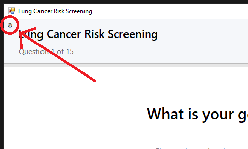
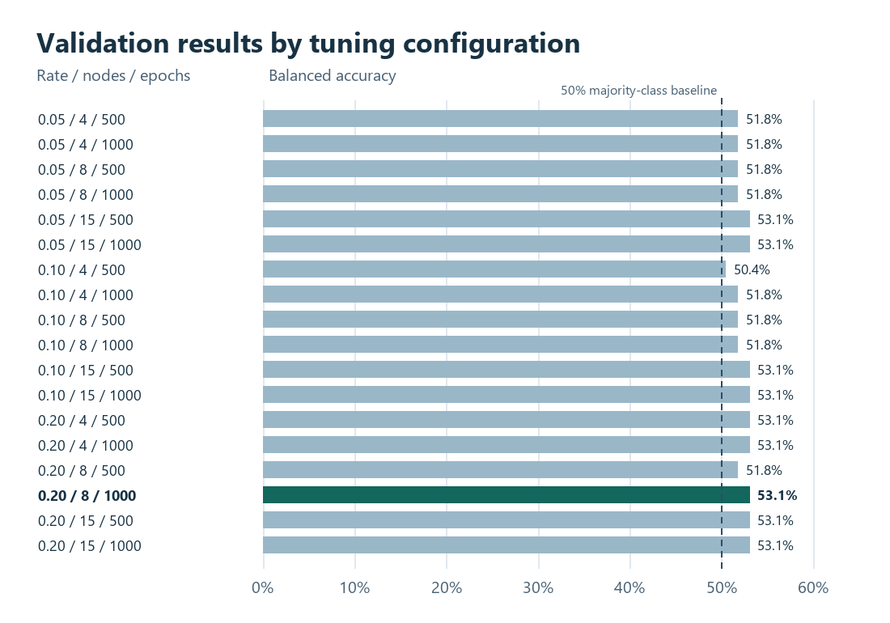
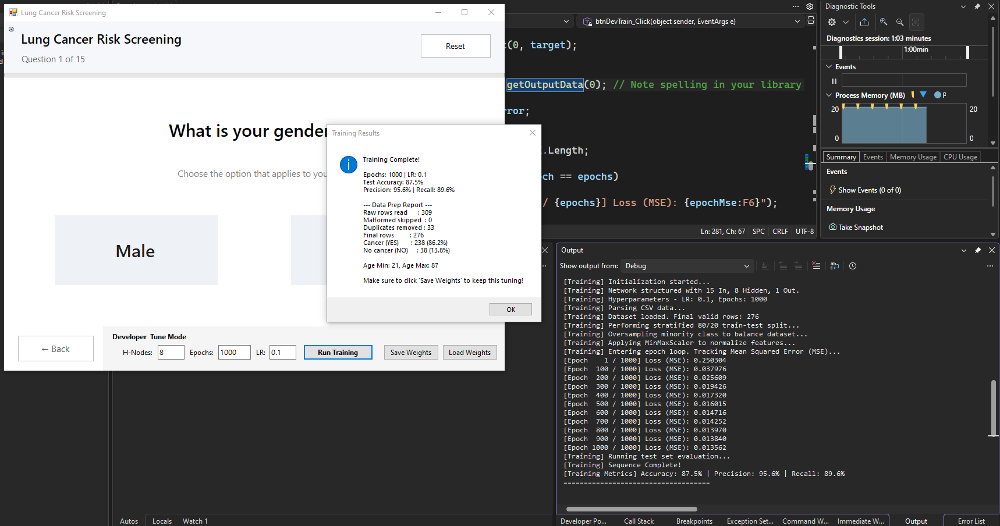

# Lung Cancer Risk Predictor (Custom C# Neural Network)

A Windows Forms class project that uses a custom three-layer C# neural network to classify lung cancer survey records. The questionnaire displays the model score for demonstration purposes.

---

## Project Overview
* **Track:** Binary Classification (High Risk vs. Low Risk)
* **Architecture:** 15 Input Neurons, 8 Hidden Neurons, 1 Output Neuron
* **Activation Function:** Sigmoid
* **Loss Function:** Mean Squared Error (MSE)
* **Framework:** .NET Framework 4.8 (Windows Forms)

---

## Dataset & Preprocessing
* **Source:** [Kaggle - Survey Lung Cancer Dataset](https://www.kaggle.com/datasets/mysarahmadbhat/lung-cancer)
* **Total Records:** 309 raw rows (33 duplicates removed, 276 final rows)
* **Features (15 Inputs):**
  * Demographics: Gender, Age
  * Habits & Environment: Smoking, Alcohol Consumption, Peer Pressure
  * Symptoms & Health: Yellow Fingers, Anxiety, Chronic Disease, Fatigue, Allergies, Wheezing, Coughing, Shortness of Breath, Difficulty Swallowing, Chest Pain
* **Target (1 Output):** Lung Cancer (1 = Yes / High Risk, 0 = No / Low Risk)
* **Pipeline (`DataPreprocessor.cs`):**
  * Stratified 80/20 Train/Test split to preserve class distribution.
  * Minority class oversampling on training rows only.
  * Min-Max normalization fitted on training rows. The questionnaire uses the same gender encoding (Male = 1, Female = 0), binary feature encoding, and age range (21–87) as the shipped model.

---

## Run in Visual Studio Community

1. Install the **.NET desktop development** workload and **.NET Framework 4.8 targeting pack** in Visual Studio Installer.
2. Open `BackProp.slnx`, build the solution, and press **F5**. If your version does not open `.slnx` files, open `BackProp.csproj`.
3. Complete the questionnaire. The app loads `lung_cancer_weights.txt` from the build output automatically. The build copies both the weights and the survey CSV.
4. Click the gear icon to open the developer panel. Set the hidden nodes, epochs, and learning rate, then click **Run Training**. Predictions use the new model as soon as training succeeds.
5. Use **Save Weights** to keep the trained model and **Load Weights** to restore it in a later session.



The executable looks for the default weights at `lung_cancer_weights.txt` and the survey at `Data/survey lung cancer.csv`, both relative to its output folder (`bin/Debug` or `bin/Release`). To make a saved model the project default, replace `lung_cancer_weights.txt` in the project folder and rebuild so Visual Studio copies the updated file to the output folder.

## Reproduce tuning and final evaluation

Build **Release** in Visual Studio. In PowerShell at the project root, run:

```powershell
$run = Start-Process -FilePath .\bin\Release\BackProp.exe -ArgumentList '--tune', 'model-run' -NoNewWindow -Wait -PassThru
if ($run.ExitCode -ne 0) { throw "Model run failed with exit code $($run.ExitCode)." }
Get-Content .\model-run\training_log.txt
```

The command writes all 18 validation trials, the final training log, and the selected model weights to `model-run`. It uses fixed seeds for the split, initialization, oversampling, and shuffle.

The split reserves 56 rows for final testing. The other 220 rows are split into 176 tuning training rows and 44 validation rows. The grid tests 4, 8, and 15 hidden nodes, learning rates of 0.05, 0.10, and 0.20, and 500 and 1,000 epochs. Each trial fits scaling and oversamples using only its training rows. The search ranks trials by validation balanced accuracy, the average of positive and negative recall. It breaks ties with final training MSE.

The search selected **8 hidden nodes, 1,000 epochs, and a learning rate of 0.20**. The winner reached **53.07% validation balanced accuracy**. Several settings tied at that score. The small validation set contains only six negative examples, so its estimate is sensitive to individual cases. See the [complete validation results](tuning_results.csv).



## Final training and results

After selecting the settings, the pipeline refits on all 220 development rows, saves the weights, and evaluates the reloaded model on the 56 test rows. The [training log](training_log.txt) shows training MSE dropping from **0.245384** to **0.009290**.



| Test metric | Result |
| --- | ---: |
| Accuracy | 85.71% |
| Precision | 93.48% |
| Recall | 89.58% |
| Specificity | 62.50% |
| Balanced accuracy | 76.04% |

The confusion matrix is 43 true positives, 5 true negatives, 3 false positives, and 5 false negatives. Predicting the majority class for every test row also gives 85.71% accuracy and gives 50.00% balanced accuracy. The trained model correctly classifies 5 of the 8 negative examples and misses 5 of the 48 positive examples.

**Developed by BENITEZ, SILVA**

